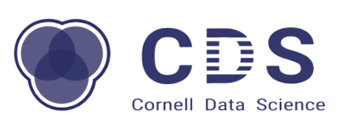

# Temi Adebowale

**` Cornell University Undegraduate (Software Developer/ Product Manager / Investor)`**

### Where I’m involved

<a href="https://urmc.cs.cornell.edu/"><picture><source media="(prefers-color-scheme: dark)" srcset="./assets/organizations/urmc-white.png"></picture></a> <a href="https://new.cornelldti.org/"><picture><source media="(prefers-color-scheme: dark)" srcset="./assets/organizations/dti-dark.png"></picture></a> <a href="https://cornelldata.science/"><picture><source media="(prefers-color-scheme: dark)" srcset="./assets/organizations/cds-white.png"></picture></a> <a href="https://tgipay.com/"><picture><source media="(prefers-color-scheme: dark)" srcset="./assets/organizations/tgi-dark.png"></picture></a> 
  

---

### Languages/Tools Programmed in: 

